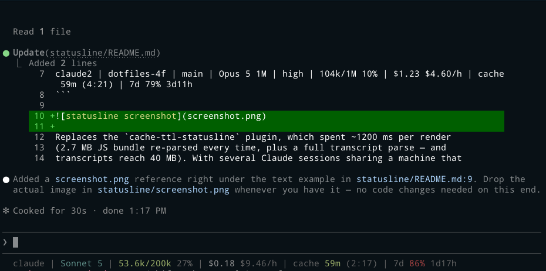

# statusline

Claude Code statusline:
`profile · worktree/peer name · branch · model · effort · context · cost + burn rate · cache expiry · rate-limit windows`.

```
c2 · dotfiles-4f · main · O5 1M · high · 104k/1M 10% · $1.23 $4.60/h · ttl 59m · 7d 79% 3d11h
```



Replaces the `cache-ttl-statusline` plugin, which spent ~1200 ms per render
(2.7 MB JS bundle re-parsed every time, plus a full transcript parse — and
transcripts reach 40 MB). With several Claude sessions sharing a machine that
cost was multiplied per session, which is what pinned a core.

## Install

```sh
./install.sh
```

Builds `~/.local/bin/statusline`, copies the Node fallback to
`~/.local/share/statusline/`, and prints the command to put in `statusLine`.
Every profile shares the one build; the binary reads the profile from
`CLAUDE_CONFIG_DIR`.

`link.sh` skips this directory, since it needs compiling rather than
symlinking. `claude/sync-profiles.sh` runs `install.sh` and writes the
`statusLine` setting into every profile.

`refreshInterval: 30` makes Claude Code re-run the statusline every 30 s.
Without it, an idle session stops re-rendering and `ttl` freezes.

## Where the data comes from

Almost all of it is in the JSON the harness writes to stdin: `context_window`
(including `context_window_size`), `prompt_cache.expires_at`, `rate_limits`,
and `cost`. A render is one JSON parse plus a handful of `stat` calls for the
three fields that are not in the payload — the profile label, the peer name and
the git branch. The transcript is never opened.

That is worth stating because it was not always so. Earlier versions rebuilt
`context` and `cache` by seeking backwards through the transcript for the last
`usage` record, and fetched `rate_limits` from `api.anthropic.com` in a forked
`refresh.sh`, with a cache file, an `O_EXCL` lock, a failure backoff and
per-profile keychain lookups — roughly 300 lines and a shell script to keep two
implementations of a token read in step. All of it is now one field each.

Verified against 31 payloads captured from live sessions on 2.1.257. The three
fields are recent; on a harness that does not send them they simply do not
render, and everything else is unaffected.

## Fields

- **profile** — the `CLAUDE_CONFIG_DIR` basename with its dot stripped, so
  parallel configs are told apart at a glance: `~/.claude` is `c`, `~/.claude2`
  is `c2`. Any other name (`.claude-memory`) shows in full.
- **model** — the display name with its first word cut to an initial and the
  `(1M context)` suffix turned into `1M`: `Opus 5 (1M context)` is `O5 1M`,
  `Fable 5.1` is `F5.1`. A name not shaped "word, space, digit" shows as sent.
- **worktree** — basename of the directory holding `.git` (dir or file),
  walking up from `cwd`. For a linked worktree (e.g.
  `.claude/worktrees/foo`) this is `foo`, not the main repo's name — the same
  name `git worktree list` shows. Absent outside a git repo, and absorbed by
  the peer name below when that already opens with it.
- **peer name** — the address other sessions message this one by, e.g.
  `SendMessage({to: "dotfiles-4f"})`. The harness keeps a registry of live
  sessions at `$CLAUDE_CONFIG_DIR/sessions/<pid>.json`; the entry whose
  `sessionId` matches stdin's `session_id` holds the name. Names are derived as
  `<project>-<suffix>`, so a name starting with the worktree name replaces that
  field instead of repeating it — a renamed session (`reviewer`) renders
  alongside it as `dotfiles · reviewer`. Absent when the registry has no entry,
  which is how a non-interactive harness renders.
- **branch** — read straight from `.git/HEAD` under `cwd` (walking up to find
  it, and following a worktree/submodule's `gitdir:` redirect), never a `git`
  subprocess. Detached HEAD shows a short hash. Absent outside a git repo, and
  hidden when it equals or ends in `-<name>` of the worktree or peer name
  (`worktree-warm-conjuring-sprout`).
- **effort** — the session's reasoning-effort level (`low`/`medium` green,
  `high` yellow, `xhigh`/`max` red), read from `effort.level`. Absent when the
  current model does not support configurable effort.
- **context** — green/yellow/red at 65% / 85%, against the harness's own
  `context_window_size`. Deliberately not `context_window.used_percentage`,
  which counts input alone: output rolls into the next request, so adding it
  tracks what the window is about to hold. Taking the size as given also fixes
  a model whose name advertises nothing — Fable 5.1 is a 1M window with no
  `[1m]` in its id and no `(1M context)` in its display name, and the old
  sniffing scored it against 200k until usage overshot.
- **burn rate** — `total_cost_usd` over `total_duration_ms`, hidden below a
  minute where the division is meaningless.
- **cache** — countdown from `prompt_cache.expires_at` (`ttl 59m`),
  coloured green/yellow/red as it nears expiry; `cache expired` once past.
  Absent until the session has written a cache block, so a cold or
  just-resumed session shows no cache field rather than a placeholder.
- **rate-limit windows** — `5h` and `7d` plan utilisation with a countdown to
  the reset, coloured on the same 65% / 85% scale. Each is hidden below 50%,
  where it is only taking up width. A window already past its reset keeps the
  percentage and drops the countdown, which would otherwise render negative.

No cwd, deliberately — it would add little over the branch name and this
already reads `.git/HEAD` for that.

## Tests

```sh
cargo build --release && ./test.sh
```

59 cases over synthesised payloads. Asserts the Rust and Node builds render
byte-identically, and covers what is easy to get wrong: the context ceiling
taken from the payload rather than sniffed, output counted toward the window, a
zero size that would divide by zero, both burn-rate boundaries, a cache block
that is absent and one already expired, the usage windows either side of their
threshold and past their reset, git branch resolution (a nested subdirectory, a
linked worktree's `gitdir:` redirect, detached HEAD, no repo at all), and the
peer name — the worktree field it absorbs, a renamed session that does not
absorb it, and a `session_id` with no registry entry. A `want` prefixed with
`!` asserts absence instead.

`test.sh` pins `CLAUDE_CONFIG_DIR` at a fixture directory, so the suite never
reads the tester's own profile.

## Notes

`statusline.cjs` is a dependency-free Node implementation kept as a fallback for
machines without a Rust toolchain. Output is byte-identical; it is slower only
because Node's interpreter startup (~18 ms) dominates. **If you change one,
change both** — `test.sh` fails if they diverge.
